


`OPERATOR // CORTEXYN` · `NODE // THECODINGCORTEX` · `STATUS // ONLINE`

## `// CORE MODULES`

<table>
  <tr>
    <td width="20%">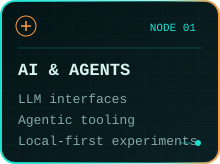</td>
    <td width="20%">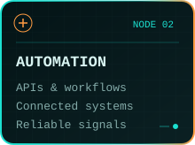</td>
    <td width="20%">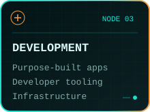</td>
    <td width="20%">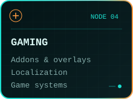</td>
    <td width="20%">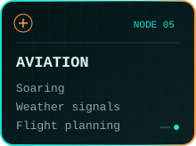</td>
  </tr>
</table>

> I build practical tools where intelligent systems, automation, and developer experience meet — software that removes friction and exposes useful signals.

## `// FEATURED TRANSMISSIONS`

<table>
  <tr>
    <td width="50%"><a href="https://github.com/Cortexyn/n8n-workflows">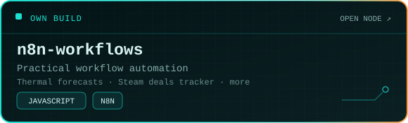</a></td>
    <td width="50%"><a href="https://github.com/Cortexyn/Termexo">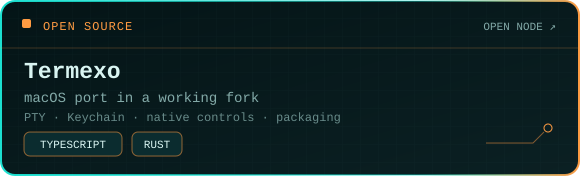</a></td>
  </tr>
  <tr>
    <td width="50%"><a href="https://github.com/Cortexyn/DoesItDie">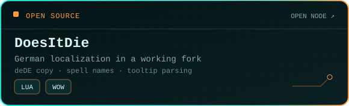</a></td>
    <td width="50%"><a href="https://github.com/Cortexyn/polestar_de">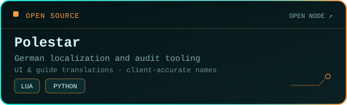</a></td>
  </tr>
</table>

`UPSTREAM NODES` · [Termexo](https://github.com/gemron/Termexo) · [DoesItDie](https://github.com/swirllyman/DoesItDie) · [Polestar](https://github.com/fitzforge/polestar)

## `// SYSTEM MATRIX`

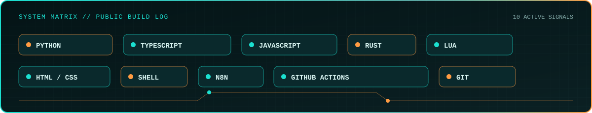

## `// PUBLIC TELEMETRY`

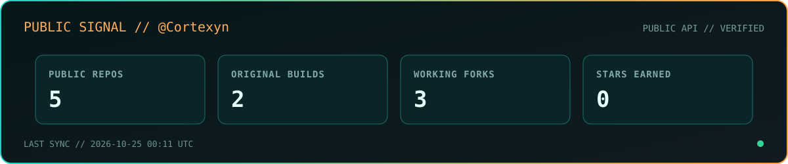

Generated by this repository's own workflow from the public GitHub API. No hand-written counters and no private-repository data.

## `// OFF-DUTY SIGNALS`

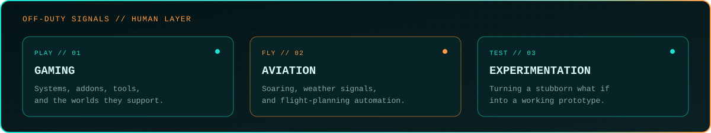

`THINK. CODE. EVOLVE.`

